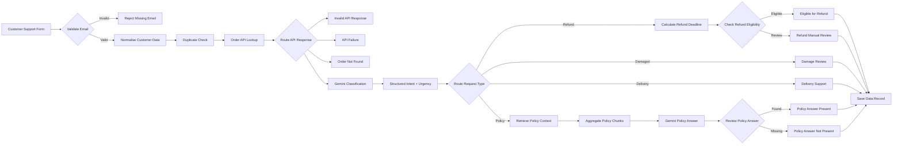

# Northstar Retail — AI Customer Support Automation

An n8n capstone project that automates customer-support requests using deterministic workflow logic, API data, Gemini classification, Retrieval-Augmented Generation (RAG), human-review fallbacks and audit storage.

## What it does

The workflow:

- receives customer requests through an n8n form
- validates required customer data
- normalises names and email addresses
- checks for repeated submissions
- retrieves order data from a mock Order API
- handles controlled API failures
- classifies customer messages with Gemini into `intent` and `urgency`
- routes refund, damaged-item, delivery and policy-question requests
- checks refund eligibility using delivery date and a 30-day return window
- uses RAG to answer policy questions from `returns_refund_policy.pdf`
- sends missing/uncertain cases to human review
- stores processed outcomes in an n8n Data Table

## Architecture



## AI and RAG

Gemini is used for structured message classification:

```json
{
  "intent": "refund | damaged_item | delivery | policy_question | other",
  "urgency": "low | medium | high"
}
```

Policy questions use a separate RAG workflow that:

1. loads `returns_refund_policy.pdf`
2. splits the document into chunks
3. creates Gemini embeddings
4. stores the chunks in an in-memory vector store
5. retrieves relevant context for customer policy questions

If the requested information is not present in the retrieved policy context, the request is sent for human review instead of inventing an answer.

## Business rules covered

- missing email → rejected
- valid delivered refund within 30 days → eligible refund
- refund outside 30 days → human review
- damaged item → high-priority review
- delivery issue → delivery support
- policy answer found → answer returned with source
- policy answer not found → human review
- API 500 → controlled API failure
- incomplete API response → invalid response handling
- repeated submission → duplicate handling

## Test coverage

The project was tested with ten end-to-end scenarios covering validation, normalisation, refund eligibility, damaged items, delivery issues, RAG found/not-found behaviour, API failures and duplicate submissions.
